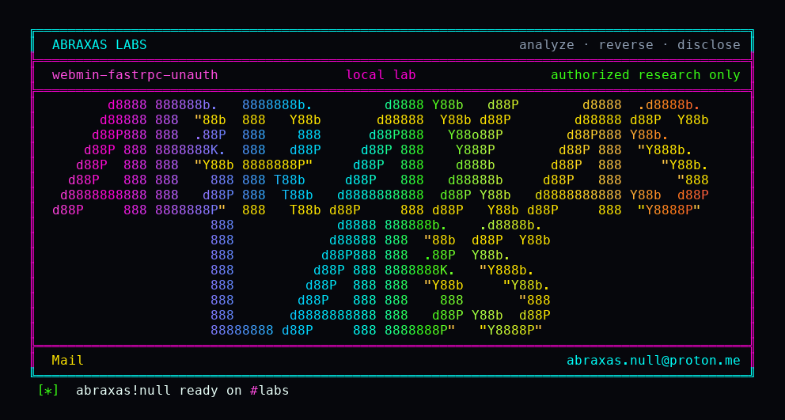

<p align="center">
  
</p>

# webmin-fastrpc-unauth

Webmin copies a file between two servers by opening a second TCP port on the destination. For up to thirty seconds that port does not ask for a login. Whoever connects first reads the file being copied, or replaces the destination, as the Webmin process user - usually root. You cannot start the copy without an RPC-capable account. You do not need one to steal the bytes once the port is open. If nobody is copying, those ports are closed.

**Class:** Missing auth on data socket
**Reach:** Remote unauthenticated, only while an RPC copy is in flight (up to 30s)

**Webmin** `2.670` (`3a2b2b86`) - Webmin

| | |
|---|---|
| ID | no CVE yet |
| Class | **Missing auth on data socket** |
| Reach | **Remote** (no session on the data socket; needs an RPC copy already in flight) |
| CWE | [CWE-306](https://cwe.mitre.org/data/definitions/306.html) |
| CVSS | **High: 8.1** `CVSS:3.1/AV:N/AC:H/PR:N/UI:N/S:U/C:H/I:H/A:N` |
| Product | [Webmin](https://github.com/webmin/webmin) |
| Affected | **2.670** (`3a2b2b8671c0669c129f5275b3dd1853106ae02b`) |
| Auth | none on `tcpwrite` / `tcpread` accept. Control connection still checks sid. |
| License | [GNU Affero GPL v3.0](LICENSE) |
| Lab | `127.0.0.1:18480` plus published data ports `18481`-`18484` |

I started the copy with a root session because that is how cluster copy works. The read and the replace used a socket that never saw a cookie. MiniServ login still wants HTTP/1.0, and a `User-Agent` that starts with `Webmin` gets a Basic 401, which is why the lab client does neither of those things.

## What an attacker can do

Needs an RPC-capable session already copying a named file. Default `rpc=2` still lets `root` / `admin` / `sysadm` open `fastrpc.cgi`. A user with `rpc=0` cannot. The window is the `select` timeout on the data child: 30 seconds. First `accept()` wins.

| Privilege | Method / sink | Recon / integrity / availability | Lab-proven or inferred |
|---|---|---|---|
| Read the named file as the miniserv user | connect to the `tcpread` data port; no sid | Recon (file read) | Lab-proven. `IOC tcpread-unauth bytes=19 body=WEBMIN-H02-FASTRPC` |
| Replace the named destination | connect to the `tcpwrite` data port; send bytes; no sid | Integrity (file write) | Lab-proven. dest became `WEBMIN-H02-FASTRPC` |
| Bind on every interface, not miniserv `bind` | `allocate_socket` `INADDR_ANY` / `in6addr_any` | Recon / integrity | Source. Lab published `18483` / `18484` to loopback |
| Steal or overwrite whatever path the RPC caller named | `remote_write` / `remote_read` then `cluster-copy` | Recon / integrity | Inferred for cluster-copy. Lab named `/tmp/h02src` and `/tmp/h02dst` |
| Negative: ports closed without a transfer | TCP 10001-10004 inside the container before `fastrpc.cgi` | n/a | Lab-proven. `IOC negative-closed 10001,10002,10003,10004` |

**Stays closed on this leftover**

| Axis | Method / sink | Why it is closed |
|---|---|---|
| Integrity | Control connection without sid | `fastrpc.cgi:136` `die` if `$auth ne $sid` |
| Integrity | User denied RPC opens the listener | `webmin_user_can_rpc()` at `fastrpc.cgi:22`; `rpc=0` returns 0 |
| Recon | Data ports with no copy in flight | nothing listens until `tcpwrite` / `tcpread` |
| Integrity | Unauthenticated `rpc.cgi` / `xmlrpc.cgi` / panel login | those paths still check session or RPC grant |
| Integrity | Standing unauth admin, CVE-2026-42210 / CVE-2026-56022 | Basic-auth 2FA bypass is a different bug |
| Integrity | Host RCE from this socket | the data child reads or writes the named file; it does not eval |

This is not a login bypass. It is a missing check on the file pipe that cluster copy leaves open.

## How I found it

I pinned [webmin/webmin](https://github.com/webmin/webmin) tag [2.670](https://github.com/webmin/webmin/releases/tag/2.670). `fastrpc.cgi` forks a control listener and returns `1 $port $sid $version`. The control line is length plus sid. `tcpwrite` and `tcpread` then fork again, `allocate_socket` on the next port, and `accept()` the first peer with no sid and no source check. `remote_write` and `remote_read` in `web-lib-funcs.pl` connect with `open_socket` and send or receive raw file bytes. Cluster Copy calls `remote_write`.

Wrong turns: treating the hello CGI as unauthenticated (it is not); looking for a second missing check on `xmlrpc.cgi`; scoring this as a standing unauth login (the ports are closed until a copy starts).

## Lab

Docker, git, python3. The compose file publishes the data ports. Loopback only.

```bash
python3 webmin-fastrpc-unauth-Abraxas-Labs.py
```

or:

```bash
cd lab
./run.sh
```

Clones [webmin/webmin](https://github.com/webmin/webmin) at `3a2b2b8671c0669c129f5275b3dd1853106ae02b` into `lab/src`, builds `webmin-lab:2.670`, and talks to `http://127.0.0.1:18480`. The launcher `chdir`s into `lab/` and execs `run.sh`.

```text
IOC negative-closed 10001,10002,10003,10004
IOC tcpread-unauth bytes=19 body=WEBMIN-H02-FASTRPC
IOC tcpwrite-unauth ack=OK dest=WEBMIN-H02-FASTRPC
SUCCESS WEBMIN-H02-FASTRPC tcpread-unauth-read tcpwrite-unauth-replace WEBMIN-H02-FASTRPC
```

## The fix

Require the RPC sid, or a per-transfer token, on the data socket before reading or writing the file. Bind that socket the way miniserv binds, not `INADDR_ANY`. Prefer connecting back to the RPC peer instead of accepting the first handshake.

## References

- [github.com/webmin/webmin](https://github.com/webmin/webmin) tag [2.670](https://github.com/webmin/webmin/releases/tag/2.670) (`3a2b2b8671c0669c129f5275b3dd1853106ae02b`)
- [`fastrpc.cgi`](https://github.com/webmin/webmin/blob/3a2b2b8671c0669c129f5275b3dd1853106ae02b/fastrpc.cgi) (`:22`, `:136`, `:180-247`, `:261-317`, `:395-428`)
- [`web-lib-funcs.pl`](https://github.com/webmin/webmin/blob/3a2b2b8671c0669c129f5275b3dd1853106ae02b/web-lib-funcs.pl) `remote_write` `:8985`, `remote_read` `:9044`, `webmin_user_can_rpc` `:14297`
- [`cluster-copy/cluster-copy-lib.pl`](https://github.com/webmin/webmin/blob/3a2b2b8671c0669c129f5275b3dd1853106ae02b/cluster-copy/cluster-copy-lib.pl) `:200`
- [CWE-306](https://cwe.mitre.org/data/definitions/306.html)

## License

GNU Affero GPL v3.0. See [LICENSE](LICENSE). Loopback lab only. No warranty.

Abraxas Labs
abraxas.null@proton.me
